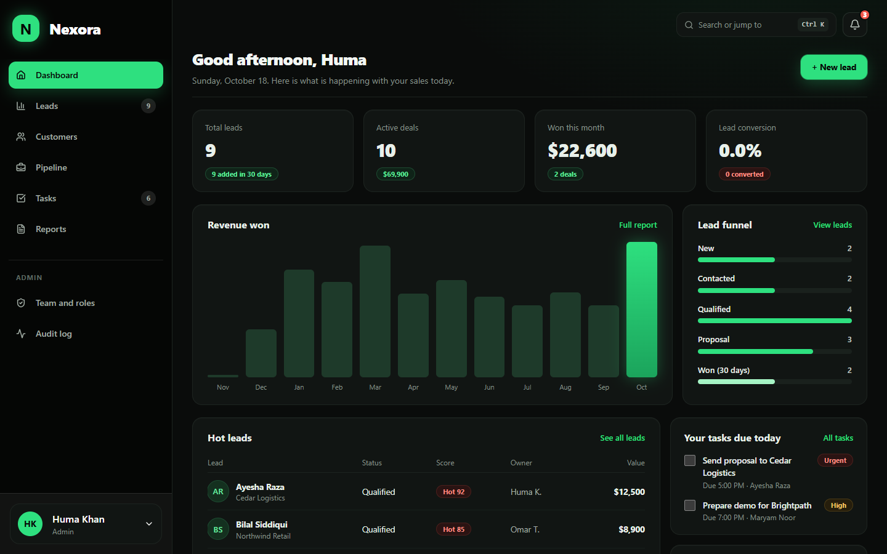
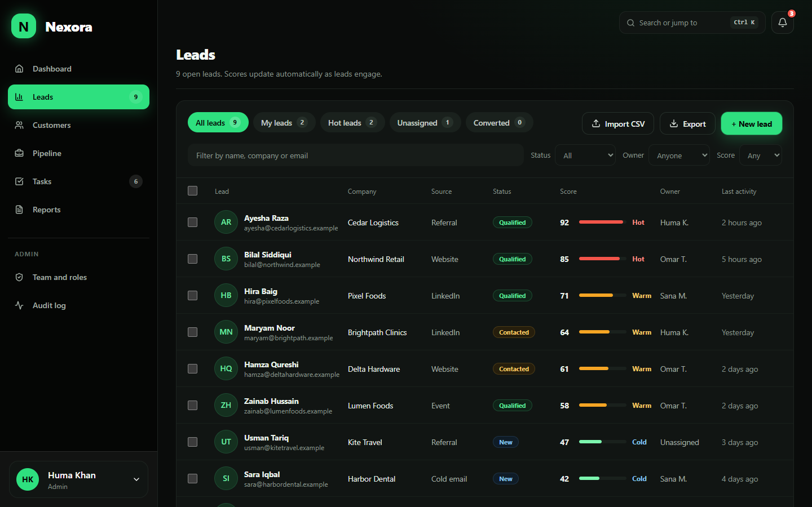
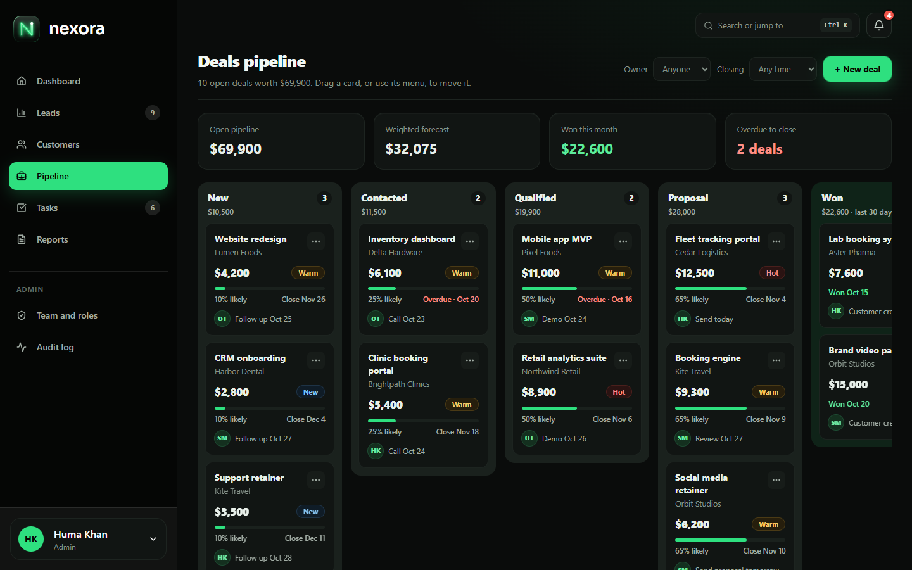
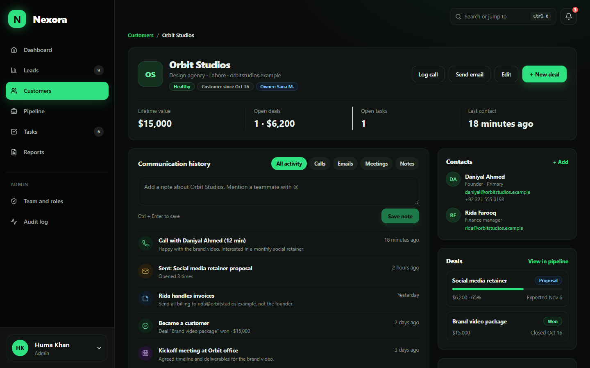
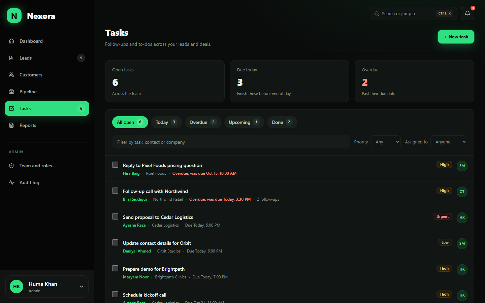
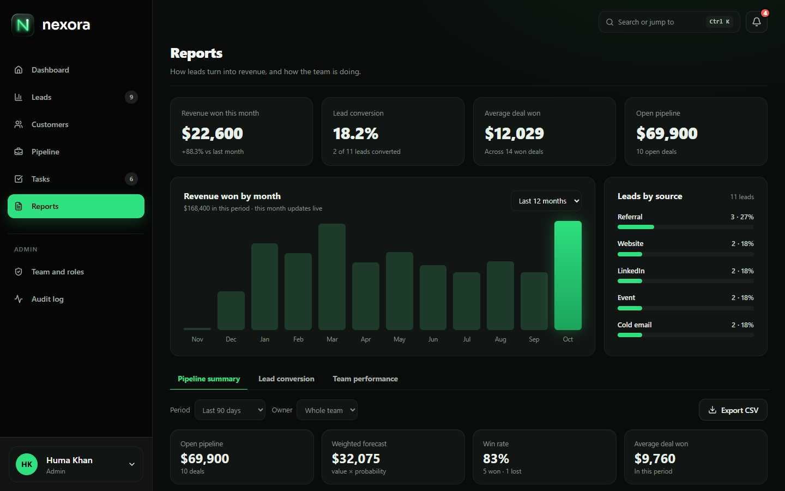
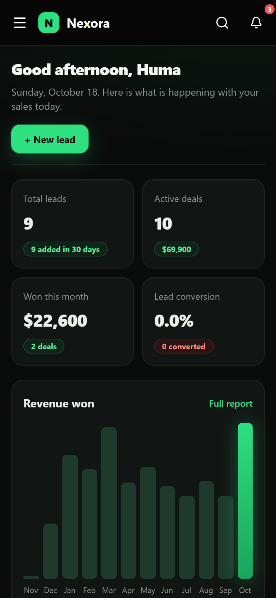

# Nexora CRM

A sales CRM for managing leads, customers, deals and follow-up tasks, with role-based access for Admins, Managers and Sales reps.

**Frontend:** Next.js 16, React 19, TypeScript, Tailwind CSS 4 · **API:** Laravel 13 (PHP 8.3) with Sanctum · **Database:** MySQL or SQLite



| Leads | Pipeline | Customer profile |
|---|---|---|
|  |  |  |

| Tasks | Reports | On a phone |
|---|---|---|
|  |  |  |

## Documentation

| | |
|---|---|
| [User guide](docs/USER-GUIDE.md) | How to use every module, what each role can do, and a five-minute tour |
| [Architecture](docs/ARCHITECTURE.md) | How the app is built, why this stack, how the modules interact, security, and how it would scale |
| [Database](docs/DATABASE.md) | Diagram of every table and relationship, design decisions, and the demo data |
| [CRM concepts](docs/CRM-CONCEPTS.md) | What a CRM is for, how each department benefits, and where every requirement of the brief lives |
| [AI usage](docs/AI-USAGE.md) | Which AI tools were used and how |

## Quick start

**Windows:** these commands work in PowerShell, Command Prompt and Git Bash. Run each line on its own.

**You need:** [Node.js](https://nodejs.org) 20.9 or newer, [PHP](https://www.php.net/downloads) 8.3 or newer, and [Composer](https://getcomposer.org). No database server is needed: by default the data lives in a single SQLite file.

```bash
git clone https://github.com/emankhann/nexora-crm.git
cd nexora-crm
npm run setup      # checks your tools, installs everything, creates the database with demo data
npm run dev:all    # starts the API, the reminder scheduler and the app together
```

Open **http://localhost:3000** (use `localhost`, not `127.0.0.1`, so the app and the API share sign-in cookies). `Ctrl+C` stops everything. On Windows, npm then asks "Terminate batch job (Y/N)?": everything has already stopped, so answer `Y`.

**Emails:** by default, invites, password resets, task reminders and lead assignments are written to `backend/storage/logs/laravel.log` instead of being sent, so no mail account is needed (open the link from there). To send real emails, see [Sending real emails](#sending-real-emails).

`npm run setup` is safe to run again, but it resets the database to the demo data.

> **Windows:** if setup says the SQLite extension isn't turned on, open your `php.ini` (`php --ini` shows where it is), remove the `;` in front of `extension=pdo_sqlite` and `extension=sqlite3`, save, and open a new terminal.

### Demo accounts

All demo accounts use the password **`demo1234`**. On the sign-in page you can also click an account to fill it in.

| Role | Email | What they can do |
|---|---|---|
| Admin | huma@nexora.example | Everything, including Team and roles, the Audit log and deleting records |
| Manager | omar@nexora.example | Sees the whole team's records, can reassign and export |
| Sales rep | sana@nexora.example | Sees and edits only their own leads, deals and tasks |

New to the app? Follow the [five-minute tour](docs/USER-GUIDE.md#13-a-five-minute-tour).

### Using MySQL

1. Create an empty database, for example `nexora`.
2. In `backend/.env`, replace `DB_CONNECTION=sqlite` with:
   ```
   DB_CONNECTION=mysql
   DB_HOST=127.0.0.1
   DB_PORT=3306
   DB_DATABASE=nexora
   DB_USERNAME=root
   DB_PASSWORD=
   ```
3. Run `npm run setup` again (or just, from the backend folder, run `php artisan migrate:fresh --seed`).

### Running the parts separately

`npm run dev:all` runs these three for you. To run them in three separate terminals instead, each starting in the project root:

```bash
# Terminal 1: the API on http://localhost:8000
cd backend
php artisan serve

# Terminal 2: sends task reminder emails when they're due
cd backend
php artisan schedule:work

# Terminal 3: the app on http://localhost:3000
npm run dev
```

### Emails when running locally

No mail service is needed. With `MAIL_MAILER=log` (the default), emails are written to `backend/storage/logs/laravel.log` instead of being sent, plus one readable line with the link:

```
Email link for ali@nexora.example (Invite): http://localhost:3000/accept-invite?token=…&email=…
```

- **Invite someone:** Team and roles → *+ Invite member*, then open the link from the log in a private window. They choose a password and are signed in.
- **Forgot password:** on the sign-in page, then open the reset link from the log. Links work once, for 60 minutes.
- **Task reminders:** tasks with email reminders on send an email when the reminder time comes, while the scheduler runs. To send due reminders right away, from the backend folder, run `php artisan nexora:send-task-reminders`.

### Sending real emails

The emails are real Laravel notifications; only the delivery is a setting. To have invites, password resets, task reminders and lead assignments arrive in a real inbox, sent from a Gmail account:

1. Turn on **2-Step Verification** on your Google account, then create an **app password** at [myaccount.google.com/apppasswords](https://myaccount.google.com/apppasswords) (name it "Nexora"). Use it, not your normal Gmail password.
2. Open `backend/.env` and replace the `MAIL_` lines with this block, using your address and app password:
   ```
   MAIL_MAILER=smtp
   MAIL_HOST=smtp.gmail.com
   MAIL_PORT=587
   MAIL_SCHEME=null
   MAIL_USERNAME=you@gmail.com
   MAIL_PASSWORD="your 16-character app password"
   MAIL_FROM_ADDRESS="you@gmail.com"
   MAIL_FROM_NAME="Nexora CRM"
   ```
3. In `.env.local`, set `NEXT_PUBLIC_EMAILS_IN_LOG=false`.
4. From the backend folder, run `php artisan config:clear`, then restart `npm run dev:all` from the project root.
5. Test it: from the backend folder, run `php artisan nexora:send-test-email you@gmail.com`.

Invites, password resets, task reminders and lead assignments now arrive in real inboxes, sent from your Gmail. Your password stays in `backend/.env`, which Git never commits.

For production, use the same settings with a mail service such as Resend, Brevo or Mailgun (see "Before going live").

- The links in the emails point to `http://localhost:3000`, so open them on the computer running the app.
- **Demo accounts never get real emails.** Addresses on reserved test domains (`.example`, `.test`, `.invalid`, `.localhost`, and `example.com/.net/.org`), like `huma@nexora.example`, can't receive email, so Nexora doesn't send to them (they would only come back as bounces). Their "Email link for …" line is still written to `backend/storage/logs/laravel.log`, so you can open the link from there. In an email to several people, only the reserved addresses are dropped.
- **Switch back to `MAIL_MAILER=log` (and `NEXT_PUBLIC_EMAILS_IN_LOG=true`) before running the check scripts.** They were written for the log mailer and read the links from the log.

## What's in the app

- **Dashboard:** live stats, 12-month revenue chart, lead funnel, hot leads, deals closing soon, team results, your tasks due today, *Needs attention* and recent activity.
- **Leads:** create, edit, search, filter, assign, bulk actions, CSV import and export, and an explainable lead score. Log calls, emails and meetings with a follow-up task, and convert a lead into a customer and a deal in one step.
- **Customers:** company profiles with contacts, the full communication history (including from when they were a lead), deals, open tasks, health and lifetime value.
- **Pipeline:** six stages from New to Won and Lost, drag and drop, probability by stage, close dates, lost reasons.
- **Tasks and follow-ups:** assignee, due time, priority, reminders in the app and by email, a follow-up history with outcomes, snooze, complete and undo.
- **Reports:** pipeline summary, lead conversion by source, and team performance, filtered by period and owner, with CSV export.
- **Users and security:** Admin, Manager and Sales rep roles enforced by the API; invites by email; password reset and change; sign-in lockout; audit log of every change.
- **Everywhere:** Ctrl K search, a reminders bell, and layouts that work on phones, tablets and laptops.

More in the [user guide](docs/USER-GUIDE.md).

## Tests

**Backend** (41 tests, on an in-memory SQLite database, nothing to set up):

```bash
cd backend
php artisan test
cd ..
```

**End to end.** Five scripts drive a real browser through the running app. First start the app on freshly seeded data:

```bash
cd backend
php artisan migrate:fresh --seed
cd ..
npm run dev:all
```

Then, in a second terminal in the project root, install Playwright once and run each script from the table below, for example:

```bash
npm install --no-save playwright
node scripts/check-signin-and-data.mjs
```

| Script | Checks |
|---|---|
| `node scripts/check-signin-and-data.mjs` | Sign-in, lockout, what each role can open, data loaded from the database, sign-out, expired sessions (19 checks) |
| `node scripts/check-saving.mjs` | Creating, editing, moving, converting and deleting records through the UI, and taking a lead through its stages (16) |
| `node scripts/check-account-and-emails.mjs` | Invites, password reset, change password, customer delete and reminder emails (9) |
| `node scripts/check-same-name-owners.mjs` | Two people with the same short name are kept apart (6) |
| `node scripts/check-responsive.mjs` | Every page and dialog at phone, tablet and laptop sizes, with screenshots (38) |

`npm run lint` and `npm run build` (which type-checks everything) should also pass. `node scripts/take-screenshots.mjs` refreshes the screenshots in `docs/screenshots`.

## Project structure

```
app/                  pages (Next.js App Router)
  (auth)/             sign in, forgot and reset password, accept invite
  (app)/              the signed-in app: dashboard, leads, customers, pipeline, tasks, reports, team, audit-log
components/           screens and dialogs per module, plus shared ui/ and layout/
lib/                  crm-store (data and actions), api client, mappers, session, permissions, notifications
types/                shared TypeScript types
proxy.ts              route protection
backend/              Laravel API
  app/                controllers, requests, resources, policies, services, models, enums, notifications
  database/           migrations, seeders
  routes/             api.php, console.php (scheduler)
  tests/Feature/      API tests
docs/                 documentation, screenshots and SQL copies of the schema and demo data
scripts/              setup, dev, end-to-end checks and screenshots
```

## Before going live

The settings above are for running on your own computer. On a real server:

- **Backend `.env`:** `APP_ENV=production`, `APP_DEBUG=false` (otherwise error pages show internal details), a real `APP_URL`, and MySQL.
- **HTTPS everywhere**, plus `SESSION_SECURE_COOKIE=true` so the session cookie is only sent over HTTPS.
- **Domains:** set `FRONTEND_URL`, `SANCTUM_STATEFUL_DOMAINS` and `SESSION_DOMAIN` to the real ones. The app and the API must share a parent domain, for example `app.example.com` and `api.example.com` with `SESSION_DOMAIN=.example.com`.
- **Frontend:** set `NEXT_PUBLIC_API_URL` to the API's address, keep `NEXT_PUBLIC_SHOW_DEMO_ACCOUNTS=false`, and run `npm run build`, then `npm start`.
- **No demo data.** `php artisan db:seed` refuses to create the demo accounts in production, because their password is public. Create the first admin by hand.
- **Email:** set `MAIL_MAILER` and the `MAIL_*` settings for a real mail service (for example Resend, Brevo or Mailgun), and run the scheduler with a cron entry for `php artisan schedule:run` every minute.
