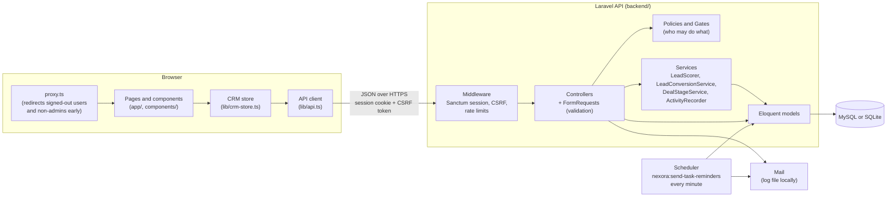
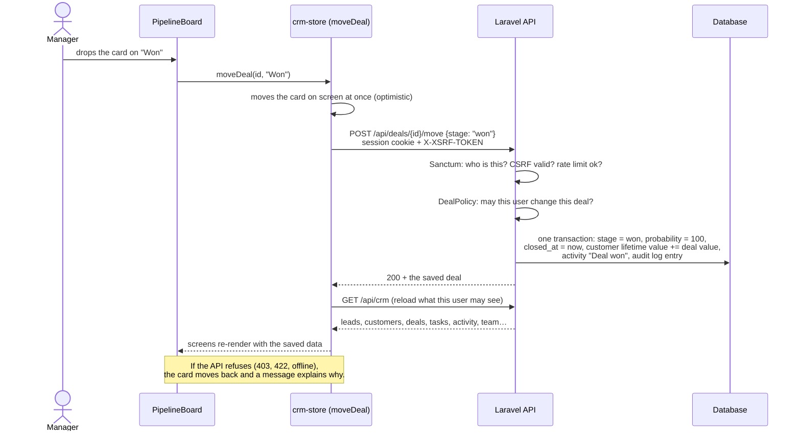
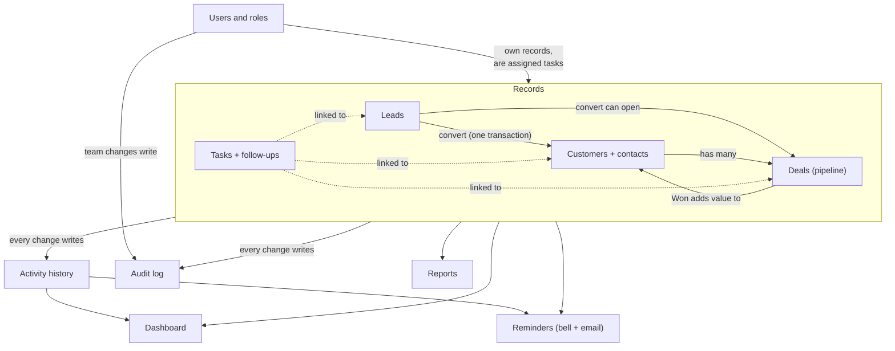

# Architecture

How Nexora CRM is put together, why it's built this way, and how it would grow.
For the tables and relationships, see [DATABASE.md](DATABASE.md). For what each screen does, see [USER-GUIDE.md](USER-GUIDE.md).

- [The big picture](#the-big-picture)
- [Why this stack](#why-this-stack)
- [How a request flows](#how-a-request-flows)
- [How the modules work together](#how-the-modules-work-together)
- [Roles and permissions](#roles-and-permissions)
- [Security](#security)
- [The frontend in more detail](#the-frontend-in-more-detail)
- [The backend in more detail](#the-backend-in-more-detail)
- [Testing](#testing)
- [Known limits](#known-limits)
- [How it would scale and improve](#how-it-would-scale-and-improve)

## The big picture

Nexora is two applications that talk over HTTP:

- **The frontend** (project root) is a Next.js app written in TypeScript. It draws every screen, keeps the data the user is allowed to see in memory, and sends every change to the API.
- **The backend** (`backend/`) is a Laravel API in PHP. It owns the database and every rule: who may see or change what, validation, lead scoring, deal stages, history, audit log, emails and reminders.



The frontend never talks to the database and never decides on its own whether something is allowed. It hides buttons a role can't use, but the API checks again on every request.

## Why this stack

| Choice | Why | Trade-off |
|---|---|---|
| **Next.js 16 + React 19 + TypeScript** | A CRM is many screens built from the same pieces (tables, forms, dialogs, badges). React components make those reusable. TypeScript catches mistakes like a misspelled field before the app runs, which matters when one record type is used on ten screens. The App Router gives each module its own folder and URL. | A second server to run alongside the API. |
| **Tailwind CSS 4 with named colours** | Fast to build a consistent, responsive UI. The green-and-black theme lives in one place (`app/globals.css`), so a colour change is one edit. | Long class lists in the markup. |
| **Laravel 13 (PHP 8.3)** | Gives the things every business app needs, built in and well tested: authentication, validation, policies, migrations, seeders, mail, a scheduler and a test framework. That leaves the time for CRM logic instead of plumbing. | PHP and Composer must be installed. |
| **Laravel Sanctum (cookie sessions)** | The browser keeps the session in an **httpOnly cookie** that JavaScript can't read, so a script injected into the page can't steal it. Tokens kept in `localStorage` can be stolen that way. | The app and API must share a parent domain (`localhost` locally). |
| **MySQL, or SQLite for a quick start** | CRM data is relational: leads, customers, deals and tasks point at each other and at users. Foreign keys, transactions and indexes keep it consistent. The migrations are database-neutral, so the same schema runs on MySQL in production and on a single SQLite file for reviewers and tests. | None that matter at this size. |
| **Playwright check scripts** | They drive a real browser through real workflows (sign in, save, invite, responsive layout), which is how the bugs that unit tests miss were found. | They need both servers running. |

## How a request flows

Example: a manager drags a deal into **Won**.



Every change follows the same shape: **one store function → one API request → the server validates, checks permission and saves in a transaction → the store reloads**. So the screen always ends up showing exactly what the database holds, including side effects the browser didn't calculate (the history entry, the new lifetime value, the recalculated lead score).

## How the modules work together



The lifecycle a record goes through:

1. **Lead.** Someone who might buy. It gets a source, a status (New → Contacted → Qualified, or Unqualified), an owner and a score. The score comes from simple, visible rules in `LeadScorer` (a referral is worth more than a cold email, a decision-maker title adds points, and so on), so a sales rep can see *why* a lead is hot.
2. **Conversion.** A qualified lead becomes a **customer** (a new company, or an existing one), and optionally a **deal**. `LeadConversionService` does all of it in one database transaction, so a failure never leaves half a conversion. The lead is kept, marked Converted, and linked to the customer, so you can always see where a customer came from.
3. **Deal.** An opportunity with a value and an expected close date, moving through New → Contacted → Qualified → Proposal → Won or Lost. `DealStageService` sets the probability from the stage, needs a reason for Lost, and adds the value to the customer's lifetime value when it's Won (and takes it off again if it's reopened).
4. **Tasks and follow-ups** keep everything moving. A task can be linked to a lead, a customer or a deal. Each follow-up attempt is logged with an outcome and can reschedule the task. Reminders appear in the bell and, if turned on, as an email when the reminder time comes.
5. **Activity history** is written by `ActivityRecorder` for calls, emails, meetings, notes, status changes, assignments, conversions and deal moves. A customer's profile shows its own history plus the history of the lead it came from.
6. **Audit log** records who did what and when, from which IP address, for every create, edit, reassignment, stage move and deletion. Only admins can read it.
7. **Dashboard, reports and reminders** don't store anything of their own. They're calculated from the records above, so they're never out of date.

## Roles and permissions

There are three roles. The rules live in two places that say the same thing: `lib/permissions.ts` decides what the UI shows, and `backend/app/Policies` plus the Gates in `AppServiceProvider` enforce it on the server.

| What | Admin | Manager | Sales rep |
|---|:-:|:-:|:-:|
| See all leads, customers, deals and tasks | ✓ | ✓ | only their own |
| Edit any record and reassign owners | ✓ | ✓ | only their own, can't reassign |
| Delete records | ✓ | | |
| Export CSV | ✓ | ✓ | |
| Team and roles (invite, change roles) | ✓ | | |
| Audit log | ✓ | | |

"Their own" is enforced in the database query itself: models use a `visibleTo($user)` scope, so a sales rep's request for "all leads" only ever reads rows where `owner_id` is their id. Records are matched to people by **user id**, never by name, so two people called "Sana M." are always kept apart.

## Security

- **Sessions:** Sanctum cookie sessions, httpOnly, with a CSRF token (`XSRF-TOKEN` cookie → `X-XSRF-TOKEN` header) on every request that changes data. If the session expires, the API answers 401 and the app sends you to sign in.
- **Every request is authorised on the server** by policies and gates, including links between records: you can't attach a task or a deal to a lead, customer or deal you can't see, and adding a lead to an existing customer needs permission to edit that customer.
- **Validation** happens in FormRequest classes, and only validated fields are saved, so a request can't set fields it shouldn't (like `lifetime_value`).
- **Rate limits:** each sign-in-related form has its own limit (sign in, forgot password, reset, invite check, invite accept, change password), plus 240 requests a minute for the rest of the API. Five wrong passwords lock sign-in for that email from that IP address for 15 minutes.
- **Passwords:** at least 8 characters with letters and numbers, hashed with bcrypt. Reset and invite links are single-use, stored hashed, and expire (60 minutes and 7 days). Resetting or changing a password signs the account out everywhere else.
- **CSV export** neutralises cells that start with `=` or `@`, and cells that start with `+` or `-` unless they're a plain number or phone number, so a lead named `=HYPERLINK(...)` can't run as a formula in Excel.
- **Demo safety:** the seeder refuses to create the demo accounts in production, and the demo password is not in the production JavaScript.
- **History is kept:** leads, customers and deals are soft-deleted, and deletions are in the audit log.

## The frontend in more detail

```
app/(auth)/…        sign in, forgot password, reset password, accept invite
app/(app)/…         the signed-in app: one folder per module
components/<module> the screens and dialogs for each module
components/ui       shared pieces: Modal, Field, Toast, ConfirmDialog, Badge…
lib/crm-store.ts    all data and every action (createLead, moveDeal, addFollowUp…)
lib/api.ts          fetch wrapper: cookies, CSRF, retry on expired CSRF, errors
lib/api-mappers.ts  API JSON → the records the screens use
lib/permissions.ts  who can do what in the UI
lib/session.ts      sign in / out, the signed-in user
lib/notifications.ts reminders for the bell, worked out from the data
proxy.ts            early redirects (signed out → /login, non-admin → /forbidden)
```

- **One store.** After sign-in, `GET /api/crm` returns everything the user may see in one response. `crm-store.ts` keeps it and components subscribe with `useCrm()` (built on React's `useSyncExternalStore`), so every screen shows the same data and updates together.
- **Optimistic updates** for actions that should feel instant (ticking a task, dragging a deal, reading reminders). The screen changes first; if the server refuses, it changes back and shows the reason.
- **Errors** from the server land where they belong: validation errors under the right form field, everything else in a toast. Network failures and expired sessions are handled once, in `lib/api.ts`.
- **Responsive:** on phones the sidebar becomes a drawer and tables become cards. A Playwright script checks every page at phone, tablet and laptop sizes for sideways scrolling.

## The backend in more detail

```
routes/api.php                 every endpoint
app/Http/Controllers/Api       one controller per module
app/Http/Requests              validation rules
app/Http/Resources             model → JSON (camelCase for the frontend)
app/Policies                   per-record rules (LeadPolicy, DealPolicy…)
app/Services                   business logic that touches several tables
app/Models (+ Concerns/HasOwner) Eloquent models, visibleTo() scopes
app/Enums                      statuses, stages, sources, roles… stored as short strings
app/Notifications              TeamInvite and TaskReminder emails
app/Console/Commands           nexora:send-task-reminders
database/migrations, seeders   the schema and the demo data
tests/Feature                  API tests (28 backend tests in all)
```

The main endpoints:

| Area | Endpoints |
|---|---|
| Sign in | `POST /login`, `POST /logout`, `GET /me`, `POST /forgot-password`, `POST /reset-password`, `PUT /me/password` |
| Invites | `POST /invites/check`, `POST /invites/accept` |
| Data | `GET /crm` (everything the user may see), `GET /reports` (the same report numbers, aggregated in SQL) |
| Leads | `apiResource leads`, `POST /leads/bulk` (assign, status, delete), `POST /leads/import` (CSV), `POST /leads/{id}/convert` |
| Customers | `apiResource customers`, `POST /customers/{id}/contacts` |
| Deals | `apiResource deals`, `POST /deals/{id}/move` |
| Tasks | `apiResource tasks`, `POST /tasks/{id}/toggle`, `POST /tasks/{id}/follow-ups` |
| Other | `POST /activities`, `POST /notifications/read`, `GET /audit-log`, `team` (list, invite, change role, resend, cancel) |

**Reminder emails** come from a scheduled command, `nexora:send-task-reminders`, run every minute by `php artisan schedule:work` (or cron in production). It finds open tasks whose reminder time has passed and that haven't been reminded yet, emails the assignee, and sets `reminder_sent_at` so each reminder is sent once. Moving the due date clears it, so the new time gets its own reminder.

## Testing

- **28 backend tests** (`cd backend && php artisan test`: 26 API feature tests plus Laravel's two example tests) on an in-memory SQLite database seeded with the demo data. They cover sign-in and lockout, what each role receives, policies, validation, lead scoring, conversion, deal stages and lifetime value, the audit log, team rules, password reset and invites (expired and reused links), reminders being sent once, rate limits being separate per form, and people with the same short name being kept apart.
- **Five end-to-end scripts** (`scripts/check-*.mjs`) drive a real browser against the running app: sign-in and data loading (19 checks), saving every kind of change (14), accounts and emails (9), same-name owners (6) and responsive layout at three screen sizes (38 pages and dialogs).
- `npm run lint` and `npm run build` (which type-checks everything) must pass before every merge.

## Known limits

These are deliberate choices for a demo-sized CRM, and the first things to change for a bigger one:

- **The app loads everything the user may see at sign-in** (`GET /api/crm`). That's simple and fast for hundreds or a few thousand records, but not for hundreds of thousands.
- **Reports are calculated in the browser** from that data. `GET /api/reports` already computes the same numbers in SQL, ready for when the data outgrows the browser.
- **Changes from other people appear on your next action or reload**, not live.
- **One currency (USD)**, no file attachments, and no customer-support tickets or marketing campaigns yet.
- **Emails are written to a log file** when running locally. A real mail service is a settings change (see "Before going live" in the README).

## How it would scale and improve

**More data and more users**
- Replace the load-everything bootstrap with **paginated, filtered endpoints** per module (the indexes for this are already there, for example `leads (owner_id, status)` and `deals (owner_id, stage)`), and switch the reports page to `GET /api/reports`.
- **Cache** dashboard and report numbers in Redis for a minute or two, and clear them when a record changes.
- Send emails through the **queue** (`QUEUE_CONNECTION=database` is already set up) so a slow mail server never slows a request down.
- **Full-text search** with Laravel Scout and Meilisearch once the Ctrl K search runs on the server.
- **Read replicas** for reports, and more API servers behind a load balancer (sessions are already in the database, so any server can handle any request).

**More teams and companies**
- **Teams or territories**, so a manager sees only their team instead of everyone.
- **Multi-tenancy** (an `organization_id` on every table and in every `visibleTo` scope) to host many companies on one installation.

**Live collaboration**
- **Real-time updates** with WebSockets (Laravel Reverb): when someone moves a deal, everyone's pipeline updates without a reload.

**Automation and AI**
- Learn the **lead score** from which leads actually converted, instead of fixed points.
- **Draft follow-up emails** and **summarise a customer's history** with a language model, from the activity timeline.
- **Next best action** on the dashboard: which lead to call first, which deal is slipping.
- **Lead capture** from a website form and email, and **WhatsApp** messages logged to the timeline (most customer conversations in Pakistan happen there).

**Running it for real**
- Docker images for the app and the API, CI that runs the tests and check scripts on every push, error tracking (for example Sentry), and backups.
