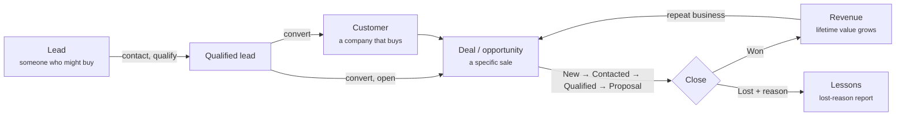

# CRM concepts, and how Nexora applies them

The brief asked to understand what a CRM is for before building one. This page sets out that understanding, how it shaped Nexora, and where each requirement lives in the app.

## What a CRM is, and why businesses use one

A **Customer Relationship Management** system is the one place a business keeps everything about the people it sells to: who they are, every conversation with them, what they might buy, and what has to happen next.

Without one, that knowledge lives in spreadsheets, inboxes, WhatsApp chats and people's heads. The same problems come up again and again:

- **Leads are forgotten.** Nobody follows up, because nobody was clearly responsible or reminded.
- **Nobody knows the full history.** A customer calls and whoever answers can't see what was promised last month.
- **Managers can't see the pipeline.** "How much will we sell this quarter?" becomes guesswork.
- **Knowledge leaves with people.** When a salesperson leaves, their contacts and deals go with them.
- **Effort can't be measured.** Which lead sources are worth paying for? Who needs help closing?

A CRM fixes this by giving every lead and customer an **owner**, a **history** and a **next step**, and by turning that data into **reports**.

## The customer lifecycle

Nexora follows this lifecycle directly. Each step is a module, and **tasks** and the **activity history** run alongside all of them, so every record always has a next step and a past.

## The essential modules

| Module | What it's for | In Nexora |
|---|---|---|
| **Lead management** | Capture interest and decide who's worth pursuing | Leads with source, status, owner and an explainable score; CSV import; bulk assign |
| **Contact and account management** | One record per company, with its people and history | Customers, contacts and a combined communication history |
| **Opportunity / pipeline management** | Track specific sales and forecast revenue | A six-stage pipeline with value, probability, close date and lost reasons |
| **Activity and task management** | Make sure the next step happens | Tasks with reminders (in-app and email), follow-up history, snooze |
| **Reporting and dashboards** | See how the business is doing and where to act | Dashboard, three report tabs, CSV export |
| **Users, roles and security** | The right people see the right data | Admin, Manager and Sales rep roles, enforced on the server; audit log |

## How each department benefits

| Department | What they need | What Nexora gives them |
|---|---|---|
| **Sales** | Know who to call today and never lose a follow-up | *My leads* sorted by activity, lead scores, *Your tasks due today*, reminders, one-click *Log call* with a follow-up |
| **Marketing** | Know which channels bring buyers, not just names | Every lead has a **source**; *Conversion by source* shows which sources actually convert; CSV import for event and campaign lists |
| **Customer support** | See a customer's full history before answering | The customer profile: contacts, every call, email and note (including from when they were a lead), deals and open tasks; **health** (Healthy, Watch, At risk) |
| **Management** | Forecast, spot problems early, coach the team | Pipeline value and weighted forecast, win rate, lost reasons, *Team performance*, *Needs attention*, and the audit log for accountability |

What Nexora doesn't do yet, and a full CRM would: support tickets, marketing campaigns and email sequences, quotes and invoices. These are listed under "How it would scale" in [ARCHITECTURE.md](ARCHITECTURE.md#how-it-would-scale-and-improve).

## Automation and AI in a CRM

A CRM is only useful if people keep it up to date, so good CRMs do as much as possible for them. Nexora automates:

- **Lead scoring:** every new lead is scored from its source, status, company size, job title and contact details. The breakdown is shown, so the score can be trusted and argued with.
- **Deal probability** follows the stage, and the **weighted pipeline** (value × probability) becomes a forecast.
- **Customer lifetime value** updates itself when deals are won or reopened.
- **Reminders:** due and overdue tasks, new assignments and late deals appear in the bell, and reminder emails are sent by a scheduled job.
- **History writes itself:** status changes, assignments, conversions and deal moves are logged without anyone typing them.
- **Needs attention:** the dashboard picks out hot leads nobody has contacted for a week, overdue tasks, late deals and at-risk customers.

Where AI could take this further (not built yet):

- **Learned lead scoring:** learn which leads actually convert, instead of fixed points.
- **Writing help:** draft a follow-up email from the conversation so far, or summarise a customer's history before a call.
- **Next best action:** suggest who to call first, and warn when a deal looks likely to slip.
- **Data entry:** turn a pasted email signature or a business card photo into a lead.

## Requirements checklist

Every requirement in the brief, and where to find it.

### A. Dashboard
| Requirement | Where |
|---|---|
| Overview of leads, customers, deals and activities | Dashboard: four stats, hot leads, deals closing soon, recent activity |
| Visual statistics and performance summaries | Revenue chart (12 months), lead funnel, *Team this month* |
| Upcoming tasks and follow-up reminders | *Your tasks due today*, *Needs attention*, the bell |

### B. Lead management
| Requirement | Where |
|---|---|
| Create, edit, view, search and manage leads | Leads page and lead page; search, filters, tabs, pages; bulk actions; CSV import and export |
| Assign leads to team members | Owner on the lead form, *Change owner*, bulk *Assign owner* |
| Track lead sources and statuses | Source and status on every lead; filters; *Conversion by source* report |
| Convert qualified leads into customers or opportunities | *Convert to customer*: new or existing customer, optional deal, one transaction |

### C. Customer management
| Requirement | Where |
|---|---|
| Customer and company profiles | Customers page and customer profile (industry, size, website, city, health, owner) |
| Contact information and communication history | Contacts; communication history including the original lead's |
| Associated leads, deals, tasks and notes | The profile links the original lead and lists deals, open tasks and notes |

### D. Sales pipeline
| Requirement | Where |
|---|---|
| Manage deals through sales stages | Pipeline board: drag and drop or card menu, six stages, Won and Lost |
| Track values, expected close dates and progress | Value, close date, probability and next step on each card; late deals marked |
| Display opportunities in a structured pipeline | Columns per stage with totals; filters by owner and close date |

### E. Tasks and follow-ups
| Requirement | Where |
|---|---|
| Create and assign tasks | Task form, with assignee, type, priority and the lead or customer it's about |
| Deadlines and reminders | Due date and time; reminder 15 min, 1 h or 1 day before; in-app and email |
| Follow-up histories | *Log a follow-up* on a task: outcome, note, reschedule; full history kept |

### F. User management
| Requirement | Where |
|---|---|
| Secure login and authentication | Sanctum cookie sessions, CSRF, lockout after 5 tries, password reset, invites, change password |
| Administrator, Manager and Sales Executive roles | Admin, Manager and Sales rep, set when inviting and changeable by an admin |
| Role-based permissions and data access | Server-side policies and `visibleTo` scopes; the UI matches; permission table on Team and roles |

### G. Reports and analytics
| Requirement | Where |
|---|---|
| Lead conversion reports | Reports → *Lead conversion*: funnel and conversion by source |
| Sales pipeline summaries | Reports → *Pipeline summary*: by stage, weighted value, win rate, lost reasons |
| Team performance tracking | Reports → *Team performance*, and *Team this month* on the dashboard |
| Basic filtering and reporting | Period and owner filters; CSV export of every report |

### Submission
| Requirement | Where |
|---|---|
| Working application, runnable locally | `npm run setup` then `npm run dev:all` ([README](../README.md#quick-start)) |
| Source code | This repository |
| Database schema, migrations and sample data | `backend/database/migrations`, `backend/database/seeders`, [DATABASE.md](DATABASE.md), `docs/database/*.sql` |
| Installation, configuration and usage instructions | [README](../README.md), [USER-GUIDE.md](USER-GUIDE.md) |
| AI usage summary | [AI-USAGE.md](AI-USAGE.md) |
