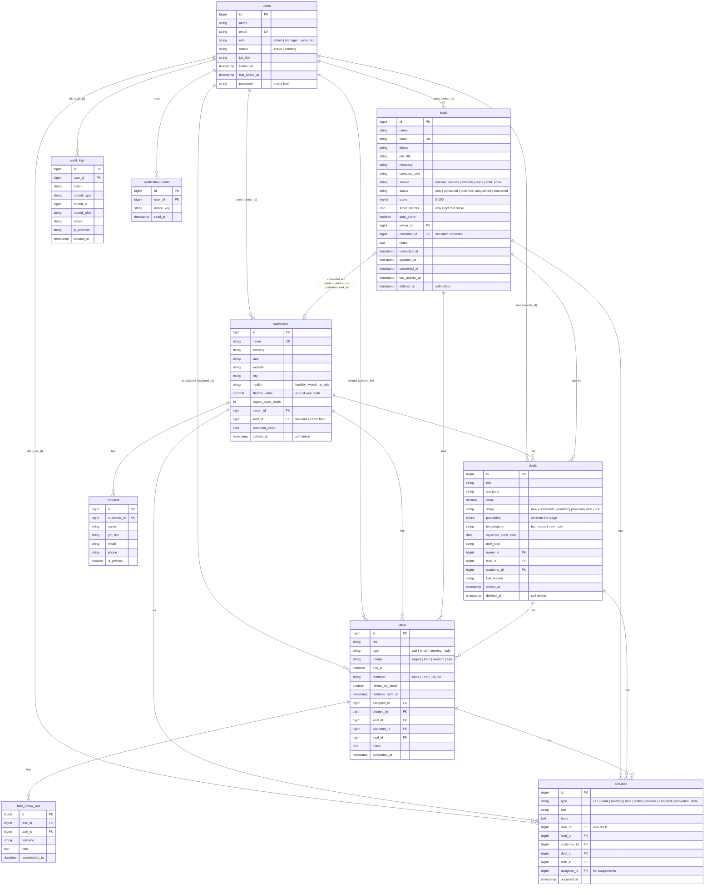

# Database

The schema is defined by the Laravel migrations in [`backend/database/migrations`](../backend/database/migrations) and filled with demo data by the seeders in [`backend/database/seeders`](../backend/database/seeders). The same migrations run on **MySQL** and **SQLite**.

Plain SQL copies, for reading without running anything:

- [`database/schema-mysql.sql`](database/schema-mysql.sql): every table, column, index and foreign key, as created on MySQL.
- [`database/sample-data-mysql.sql`](database/sample-data-mysql.sql): the demo data as `INSERT` statements.

## Diagram

Every table also has `created_at` and `updated_at` (except `audit_logs`, which only has `created_at` because entries are never edited).

## The tables

| Table | What it holds |
|---|---|
| `users` | Everyone who can sign in, with their **role** (Admin, Manager, Sales rep) and **status** (an invited person is `pending` until they accept). |
| `leads` | Potential customers. The **score** and the **score_factors** that explain it are worked out by `LeadScorer` when the lead is created. The `contacted_at`, `qualified_at` and `converted_at` dates drive the funnel. |
| `customers` | Companies that buy. **lifetime_value** is the total of their won deals, kept up to date by `DealStageService`. |
| `contacts` | People at a customer. One is marked **primary**. |
| `deals` | Opportunities in the pipeline. **probability** follows the stage (10, 25, 50, 65, 100 or 0%). **closed_at** is set when a deal is won or lost, and **lost_reason** is required for lost deals. |
| `tasks` | To-dos and follow-ups with a due time, priority and reminder. **completed_at** is empty while the task is open. **reminder_sent_at** stops a reminder email being sent twice. |
| `task_follow_ups` | Each attempt on a task: the outcome ("No answer", "Interested"…), a note, and the new time if it was rescheduled. This is the follow-up history. |
| `activities` | The timeline shown on leads, customers and deals: calls, emails, meetings, notes, status changes, assignments, conversions and deal moves. |
| `audit_logs` | Who did what, to which record, when and from which IP address. Admin-only. |
| `notification_reads` | Which reminders in the bell each person has read. |

Laravel's own tables: `sessions` (signed-in sessions), `password_reset_tokens` (hashed reset and invite tokens), `cache`, `jobs` and `personal_access_tokens`.

## Design decisions

- **Ownership is a foreign key to `users`.** Leads, customers and deals have `owner_id`; tasks have `assigned_to` (who must do it) and `created_by` (who asked). A sales rep's queries are filtered with `WHERE owner_id = their id` (or `assigned_to` for tasks), which is what keeps their data separate.
- **Deleting keeps history.** Leads, customers and deals are **soft-deleted**: the row gets a `deleted_at` date and disappears from the app, but stays in the database, so reports, history and the audit log still make sense. Only admins can delete, and the API tidies up around the record in the same transaction:

  | When an admin deletes | What the API does |
  |---|---|
  | a customer | deletes its **open** tasks, and unlinks its deals and the lead it came from, so won revenue stays in the pipeline and reports |
  | a lead | deletes its **open** tasks |
  | a task | its follow-up history goes with it |

  The foreign keys back this up for rows that are removed for good: a customer's **contacts** and a task's **follow-ups** are deleted with it (`cascade`), and links from other records are cleared (`set null`). If a user were removed, their leads, customers and deals would become unassigned rather than disappear.
- **Statuses, stages and sources are short strings** (`'qualified'`, `'at_risk'`) rather than numbers or database ENUMs. They're readable in raw SQL, work the same on MySQL and SQLite, and adding a new value doesn't need a schema change. PHP enums in `backend/app/Enums` are the single list of allowed values, and validation rejects anything else.
- **Money is `DECIMAL(12,2)`**, never floating point, so totals don't pick up rounding errors.
- **Times are stored in UTC.** The app shows them in the viewer's time zone; the seeder and reminder emails use `LOCAL_TIMEZONE` (Asia/Karachi).
- **Indexes match the queries the app runs most:**
  - `leads (owner_id, status)` and `deals (owner_id, stage)` for "my open leads/deals"
  - `tasks (assigned_to, completed_at, due_at)` for "my open tasks by due time" and the reminder command
  - `leads.last_activity_at`, `deals.expected_close_date`, `deals.closed_at` for sorting and date ranges
  - `audit_logs (record_type, record_id)` for a record's audit trail
  - unique `leads.email`, `customers.name`, `users.email`, and `notification_reads (user_id, notice_key)` to stop duplicates
- **Conversions and deal moves run in transactions**, so a lead is never converted without its customer, and a deal is never marked Won without its lifetime value and history entry.

## Demo data

`php artisan migrate:fresh --seed` creates:

| | |
|---|---|
| **Users** | Huma Khan (Admin), Omar Tariq (Manager), Sana Mirza (Sales rep), all with password `demo1234`, and Kamran Shah, an invite that hasn't been accepted yet |
| **Leads** | 9, across every source and status, with scores |
| **Customers** | 8, with contacts and a mix of health states |
| **Deals** | 25, in every stage, including 12 won over the past year so the revenue chart has history |
| **Tasks** | 8, some overdue and some due today, with follow-up history |
| **History** | Activity and audit log entries to match |

Dates are relative to the day you seed, so the dashboard always looks current. The seeder **refuses to run in production** (`APP_ENV=production`), because the demo password is public, unless `ALLOW_DEMO_SEED=true` is set on purpose.

## Changing the schema

Never edit an existing migration once it has run somewhere. Add a new one (`php artisan make:migration add_x_to_y_table`), as `2026_10_18_000001_add_reminder_sent_at_to_tasks_table.php` does, and run `php artisan migrate`.
