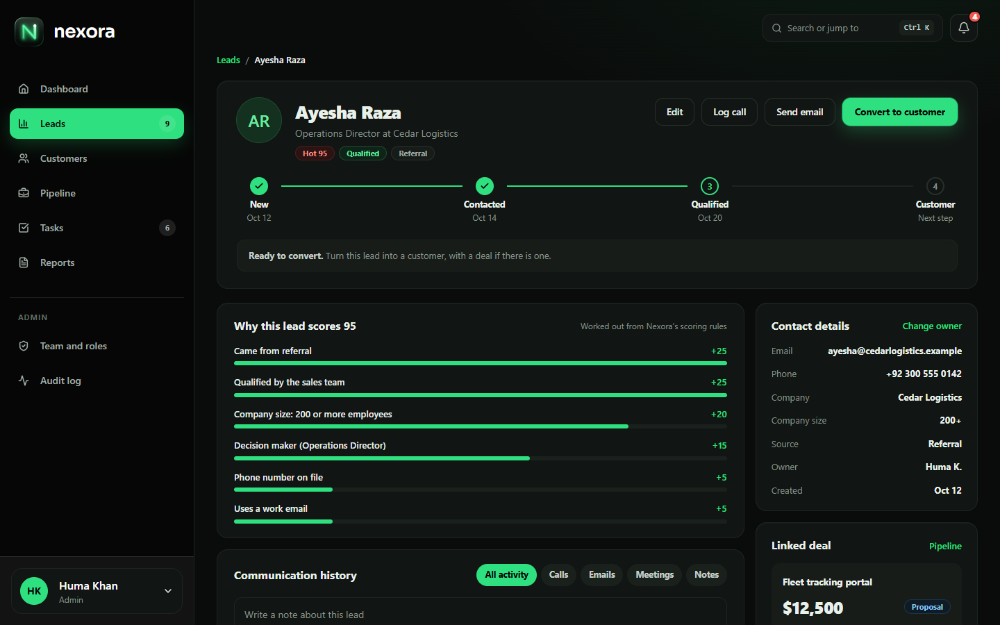
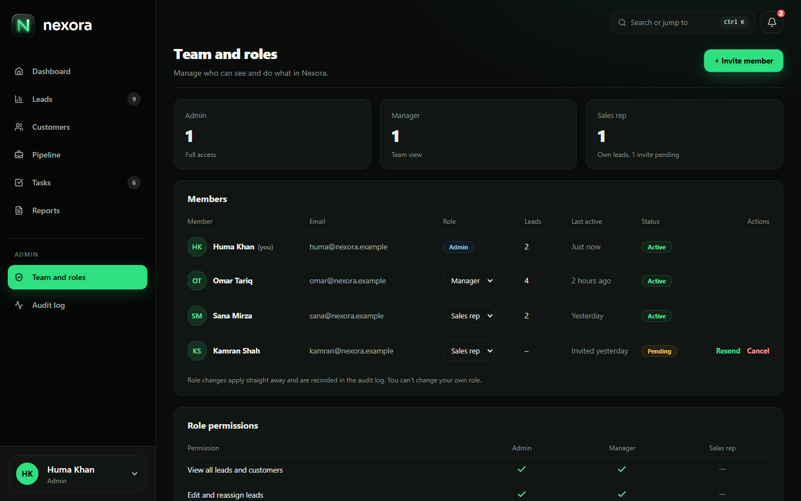

# User guide

How to use Nexora CRM day to day. To install it, see the [README](../README.md).

Sign in at **http://localhost:3000** with one of the demo accounts (password `demo1234`, or click an account on the sign-in page):

| Account | Role | Try it to see… |
|---|---|---|
| huma@nexora.example | **Admin** | everything, including Team and roles, the Audit log and deleting records |
| omar@nexora.example | **Manager** | the whole team's work: reassigning, exporting and team reports |
| sana@nexora.example | **Sales rep** | a salesperson's view: only her own leads, deals and tasks |

## Contents

1. [Getting around](#1-getting-around)
2. [The dashboard](#2-the-dashboard)
3. [Leads](#3-leads)
4. [Converting a lead](#4-converting-a-lead)
5. [Customers](#5-customers)
6. [The pipeline](#6-the-pipeline)
7. [Tasks and follow-ups](#7-tasks-and-follow-ups)
8. [Reports](#8-reports)
9. [Team and roles (Admin)](#9-team-and-roles-admin)
10. [Audit log (Admin)](#10-audit-log-admin)
11. [Your account](#11-your-account)
12. [What each role can do](#12-what-each-role-can-do)
13. [A five-minute tour](#13-a-five-minute-tour)

## 1. Getting around

- **Sidebar:** Dashboard, Leads, Customers, Pipeline, Tasks and Reports, plus Team and roles and Audit log for admins. The numbers next to Leads and Tasks are your open items. On a phone, the menu button at the top opens the sidebar.
- **Search:** press **Ctrl K** (**⌘K** on a Mac) or click the search box to find any lead, customer, deal or task by name or company. It also has quick actions: *Create a lead* and *Create a task*.
- **Bell:** your reminders. It shows overdue tasks, tasks whose reminder time has come, leads and tasks someone assigned to you in the last three days, and deals past their close date. Click one to open it. "Mark all as read" clears the badge.
- **Account menu** (your name, bottom of the sidebar): change your password or sign out.

## 2. The dashboard

Everything on the dashboard is worked out from live data, and a sales rep sees only their own numbers.

- **Four stats:** open leads, active deals, revenue won this month, and lead conversion rate.
- **Revenue won:** a bar for each of the last 12 months.
- **Lead funnel:** how many leads are New, Contacted and Qualified, how many deals are at Proposal, and how many were won in the last 30 days.
- **Hot leads:** the highest-scoring open leads.
- **Deals closing soon:** open deals due in the next 30 days, and any that are late.
- **Team this month** (managers and admins) or **Your month** (sales reps): revenue, deals won, pipeline and tasks done per person.
- **Your tasks due today:** tick a task to complete it (there's an Undo).
- **Needs attention:** hot leads nobody has contacted for a week, overdue tasks, late deals and customers at risk. Each one links to where you fix it.
- **Recent activity:** the latest calls, emails, notes, status changes and deal moves.

## 3. Leads

A lead is someone who might buy but hasn't yet.

**Find leads.** Tabs: *All leads*, *My leads*, *Hot leads*, *Unassigned* and *Converted* (sales reps see *My leads*, *Hot leads* and *Converted*). Search by name, company or email, and filter by status, owner and score.

**Add a lead.** *+ New lead* → name, email and company are required; phone, job title, company size, source, status, owner and notes are optional. The same email can't be used twice. Tick *Create another after saving* to keep the form open.

**The score.** Each new lead gets a score out of 100, and the lead page shows exactly where the points came from, for example:

| | |
|---|---|
| Came from a referral | +25 |
| Qualified by the sales team | +25 |
| Company size: 200 or more employees | +20 |
| Decision maker (Operations Director) | +15 |
| Phone number on file | +5 |
| Uses a work email | +5 |

80 and above is **Hot**, 50–79 **Warm**, below 50 **Cold**.

**Work with several leads at once.** Tick leads to *Assign owner*, *Change status* or *Delete* (admins) them together. Assigning shows Undo.

**Import and export.** *Import CSV* takes a file with a header row. **Name** and **Email** columns are required; **Company**, **Phone**, **Job title** and **Source** are used if present. Rows with a missing email, or an email that already exists, are skipped, and you're told how many. *Export* (admins and managers) downloads the leads you're looking at as a CSV file.

**The lead page.**

- **Log call / Send email:** record a call, email or meeting with its outcome (for a call: Interested, Needs follow-up, No answer, Not interested) and notes. *Create a follow-up task* is ticked by default, so the next step is scheduled in the same go.
- **Add a note:** a quick note on the timeline.
- **Edit** the lead, including its status, and **Change owner** (admins and managers).
- **Score breakdown, timeline, linked deals and open tasks.**
- **Convert to customer:** see the next section.

## 4. Converting a lead

When a lead is ready to buy, open it and click **Convert to customer**:

1. Choose **New customer** (Nexora suggests the lead's company) or add them to an **existing customer**. If a customer with the same company name exists, it's chosen for you.
2. Pick the industry and the account owner.
3. Optionally **create a deal** with a title, value, stage and expected close date.

All of it is saved together: if anything fails, nothing changes. The lead is kept, marked **Converted**, and linked to the customer, so the customer's page shows where they came from.

## 5. Customers

The customers list shows each company's primary contact, industry, lifetime value, open deals, health and owner, with search and filters.

A **customer profile** has:

- **Contacts:** the people at the company. Add more with *+ Add*.
- **Communication history:** every call, email, meeting and note for the customer *and* the lead it came from. Log new activity or add a note from here.
- **Deals:** open and closed, with a *+ New deal* button.
- **Open tasks** for this customer.
- **Lifetime value:** the total of their won deals. It updates by itself when a deal is won.
- **Health:** Healthy, Watch or At risk, set when you edit the customer. At-risk customers appear in *Needs attention* on the dashboard.

Admins see **Delete this customer** at the bottom. Open tasks are deleted; deals stay in the pipeline and reports, unlinked.

## 6. The pipeline

Deals move left to right through **New → Contacted → Qualified → Proposal → Won / Lost**. Each column shows its total value.

- **Move a deal:** drag the card to another column, or use the card's *⋯* menu (easier on a phone).
- **Probability** follows the stage: 10%, 25%, 50%, 65%, 100% for Won, 0% for Lost.
- **Won** adds the deal's value to the customer's lifetime value. **Lost** asks for a reason, which feeds the "Lost reasons" report.
- Cards show the value, temperature (Hot, Warm, New, Cold), expected close date and the next step. Late deals are marked.
- **Click a card** to edit the deal, see its history and tasks, or mark it won or lost.
- Filter by owner and by close date (*This month*, *Overdue*). Won and lost deals stay on the board for 30 days.

## 7. Tasks and follow-ups

Tabs: *All open*, *Today*, *Overdue*, *Upcoming* and *Done*. Filter by priority and (for admins and managers) by who it's assigned to.

**Create a task:** a title, type (Call, Email, Meeting, To-do), priority, due date and time, who it's for, what it's about (a lead or customer), and a **reminder** (15 minutes, 1 hour or 1 day before, or none). With *Email reminder* on, the assignee also gets an email at that time.

**Open a task** to:

- **Log a follow-up:** pick the outcome (Reached, No answer, Left voicemail, Email sent, Replied, Meeting booked), add a note, and choose what's next: *in 2 days*, *tomorrow*, *in a week*, or *Done, close the task*. Each attempt is kept in the task's **follow-up history**.
- **Snooze** to the same time tomorrow.
- **Complete** it (or reopen it).
- **Edit** or **Delete** it (whoever created it, or an admin).

## 8. Reports

Choose a period (last 30 days, last 90 days, last 12 months, or all time) and, for admins and managers, an owner. Three tabs:

- **Pipeline summary:** deals by stage with count, value, weighted value (value × probability) and average probability; win rate; average won deal; deals closing in the next three weeks; and lost reasons.
- **Lead conversion:** the funnel from all leads to converted, and conversion rate by source (which channels bring leads that actually buy).
- **Team performance:** for each person, leads, conversions, deals won, revenue, win rate, open pipeline and tasks completed.

*Export CSV* downloads the tab you're looking at.

## 9. Team and roles (Admin)

- **Invite someone:** *+ Invite member* → name, work email and role. They get an email with a link that works for 7 days, where they choose a password and are signed in. Until then they show as **Pending**, and you can **Resend** (the old link stops working) or **Cancel** the invite.
  > Running locally, emails go to `backend/storage/logs/laravel.log` instead of being sent. Open the link from there in a private window.
- **Change someone's role** from the list. You can't change your own role, and the last admin can't be demoted, so the team is never left without one.
- **The permissions table** at the bottom shows exactly what each role can do.

## 10. Audit log (Admin)

Every sign-in, create, edit, reassignment, stage move, conversion, deletion and team change, with who did it, when, the record and the details. Search it and filter by person and action.

## 11. Your account

- **Change password:** account menu → *Change password*. You need your current password. Your other devices are signed out.
- **Forgot password:** on the sign-in page. The reset link works once, for 60 minutes. Running locally, it's in `backend/storage/logs/laravel.log`.
- **Locked out?** Five wrong passwords lock sign-in for 15 minutes.

## 12. What each role can do

| | Admin | Manager | Sales rep |
|---|:-:|:-:|:-:|
| See all leads, customers, deals and tasks | ✓ | ✓ | own only |
| Create leads, customers, deals and tasks | ✓ | ✓ | ✓ (for themselves) |
| Edit records | any | any | own only |
| Reassign owners | ✓ | ✓ | |
| Delete records | ✓ | | |
| Export CSV | ✓ | ✓ | |
| Team and roles | ✓ | | |
| Audit log | ✓ | | |

## 13. A five-minute tour

A path through the main workflow, good for a first look or a demo:

1. Sign in as **Huma** (Admin). Look at the dashboard's *Needs attention* list.
2. **Leads** → *+ New lead*: add someone from a referral with a decision-maker title. Note the score and its breakdown.
3. On the lead page, **Log call** → outcome *Interested*, with a follow-up task for tomorrow.
4. **Convert to customer:** a new customer, with a deal in *Proposal*.
5. **Pipeline:** drag the new deal to **Won**. Open the customer: the lifetime value went up.
6. **Tasks:** open the follow-up and log an attempt; see the follow-up history.
7. **Reports:** see the win in *Pipeline summary* and the conversion in *Lead conversion*.
8. Sign out and sign in as **Sana** (Sales rep): she sees only her own records, and Team and roles isn't there.
